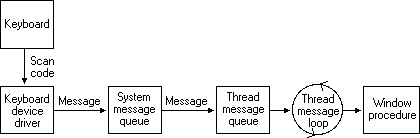

# 22. Code Page and Encoding

Application에 문자열이 도착할 때까지 어떠한 과정을 거치는 간단하게 기술합니다.  

* `스캔 코드` -> `가상 키(VK) 변환` -> `입력기(IME)` -> `코드페이지 변환` -> `인코딩/메모리 저장` -> `폰트 렌더링`

<br>

#### 스캔 코드 과정
  
[Reference] [https://learn.microsoft.com/ko-kr/windows/win32/inputdev/about-keyboard-input](https://learn.microsoft.com/ko-kr/windows/win32/inputdev/about-keyboard-input)

위 과정처럼 키보드 입력을 처리하는 OS 쓰레드가 신호를 받아 처리할 때, 입력된 키는 가상 키 코드(Virtual-Key Code)로 변환됩니다. 한글처럼 조합이 필요한 언어라면 이 단계에서 IME가 개입해 자음과 모음을 하나의 완결된 문자로 조합하게 되는 구조입니다.  
_이 과정까지는 아직 우리가 알고 있는 UTF-8, UTF-16 및 ANSI 등으로 변환되지 않았습니다._   

이 때 우리가 컴퓨터공학과에 가서 처음으로 가서 배우게 되는 ASCII 코드(문자 집합)가 코드 페이지로 사용되게 됩니다.  
단순히 문자의 고유 번호ID인 Code Point를 규칙에 맞게 가공하여 Byte로 만드는 `인코딩` 단계가 필요하게 됩니다.  

<br>  

* [영문] ASCII -> Unocode / [한국어] KSC-5601 -> KS X 1001

<br>

또한 맨 처음 코드 페이지가 나오게 될때, 언어에 따라서 코드페이지가 다르게 되어 난항을 겪게 됩니다.  
_현재 기준으로 Windows OS 커널 자체는 UniCode와 UTF-16을 기준으로 동작합니다._  
[Reference] [https://learn.microsoft.com/en-us/windows/apps/design/globalizing/use-utf8-code-page](https://learn.microsoft.com/en-us/windows/apps/design/globalizing/use-utf8-code-page)

이제 위 코드페이지를 정해진 포멧에 맞게 바이트로 변환하게 되는데 이 때 나온 것이 `UTF-8` 입니다.  
* [영문/한국어] Unicode -> UTF8
* [한국어] KS X 1001 -> EUC-KR / ANSI(CP949)  

당연히 같은 한국어 문자라도 인코딩 되는 방식이 다르기 때문에 다른 byte 결과 값으로 가공되게 됩니다.  

<br>

#### 그렇다면 이제 Unicode가 한국어도 지원하는데 Legacy인 ANSI를 아직도 사용할까요?  
* 호환성에 문제가 있습니다.  UTF-16은 빈 공간을 `\0`으로 처리하는데, 이는 C/C++ 에서 문자열이 끝났다고 해석하거나 또한 이전 Legacy들이 전부 `ANSI Win32 API`를 사용하여 마이그레이션하기 어렵습니다.  
* 그래서 선택한 방법은 CP949와 유니코드를 1:1 매핑하여 변환시키는 Wrapper 방식을 채택하였습니다.  


<br>   

## Application 문자열 입력  

```cmd
Rem cmd
echo 안녕하세요 | python -c "import sys; print(sys.stdin.encoding); print(repr(sys.stdin.read()))"
```

```powershell
# powershell
echo 안녕하세요 | python -c "import sys; print(sys.stdin.encoding); print(repr(sys.stdin.read()))"
```

